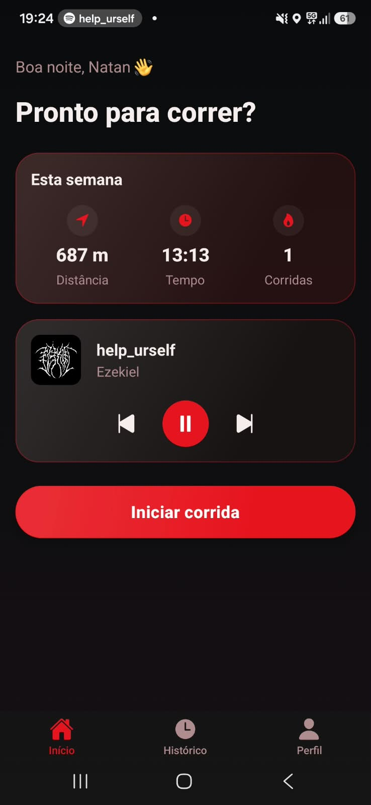
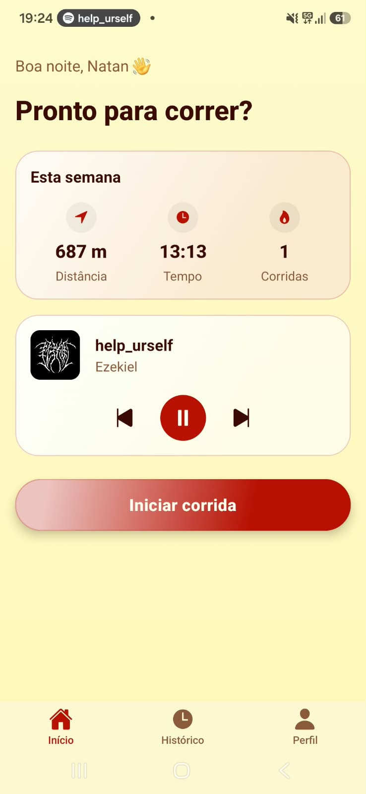
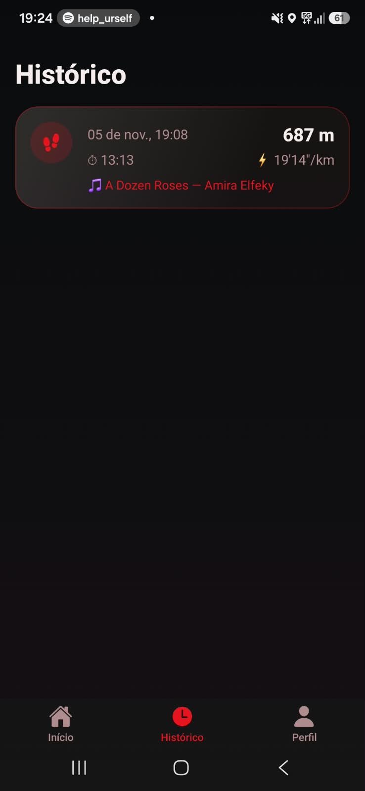
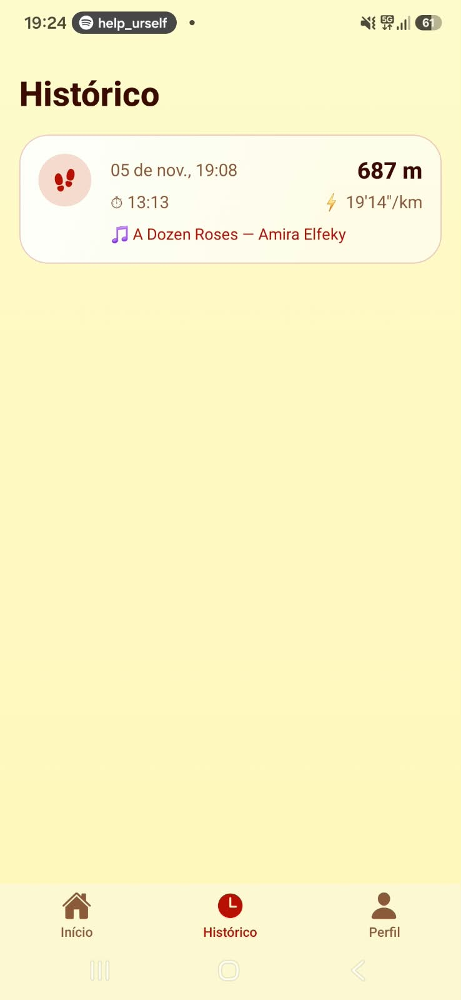
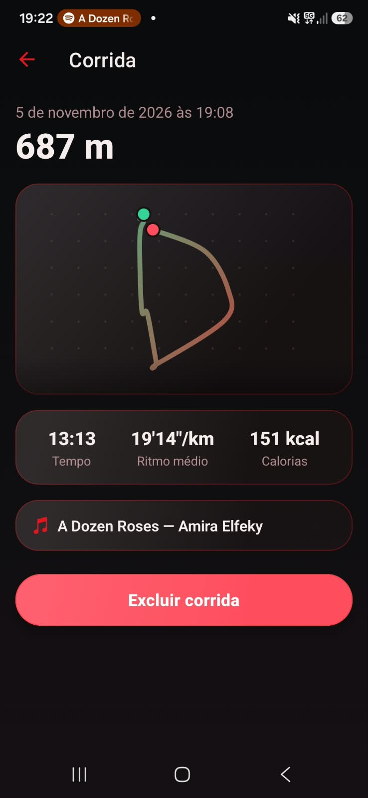
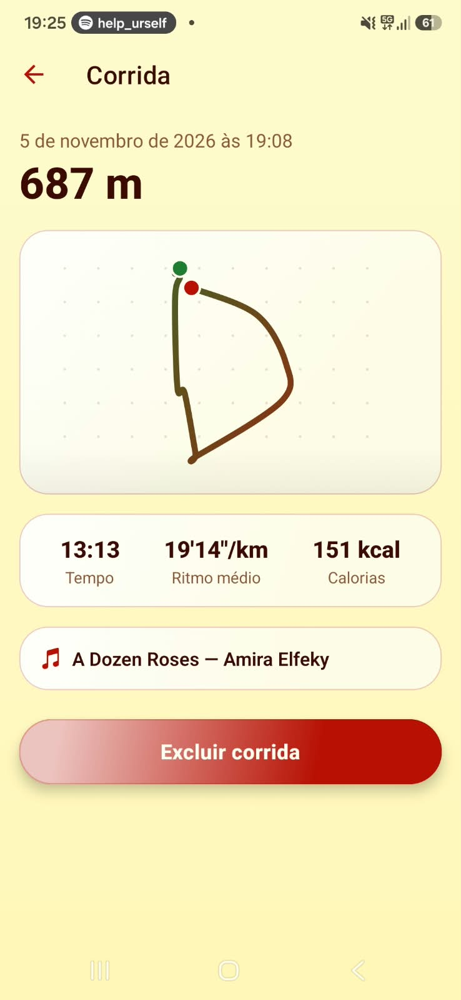
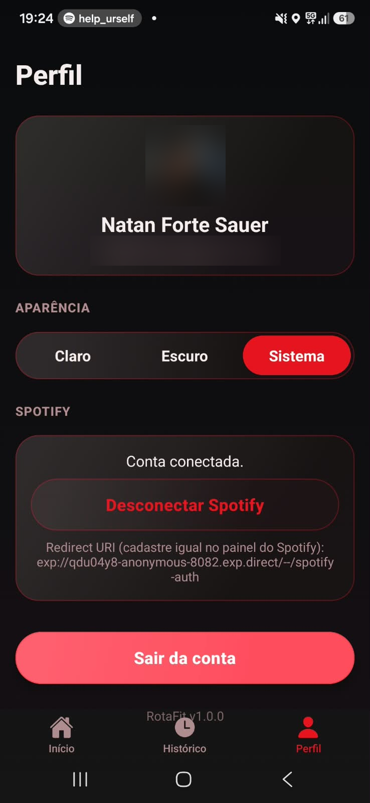
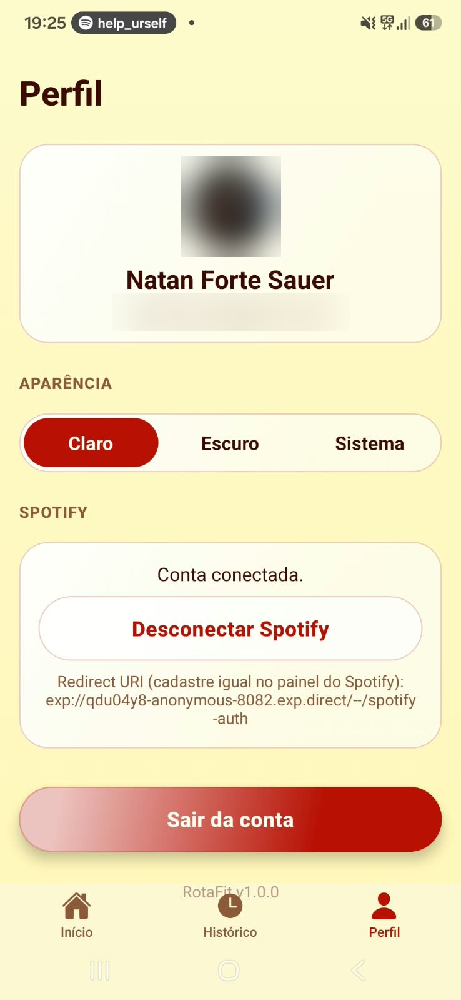

# RotaFit

App de corrida com GPS: registra a rota, a distância, o tempo e o ritmo de cada
corrida, com tema claro e escuro e um player do Spotify para tocar música
durante o treino.

Projeto 3 de 5 — Programação para Dispositivos Móveis (IESB).

## Funcionalidades

- Login com **Google** (Supabase Auth, sem senha própria)
- Corrida com GPS: distância, tempo, ritmo e traçado da rota em tempo real
- Pausar, retomar, finalizar e descartar uma corrida
- Histórico de corridas e resumo de cada uma (com o traçado)
- Estatísticas da semana (distância, tempo, número de corridas)
- **Spotify**: login OAuth (PKCE), tocando agora, tocar/pausar, próxima/anterior
- **Tema claro e escuro**, com persistência: claro em Milano Red + Lemon
  Chiffon, escuro inspirado no Flamengo
- Interface em **Liquid Glass**: superfícies translúcidas com blur, brilho e
  borda, no app inteiro

## Capturas de tela

| | Tema escuro | Tema claro |
| --- | --- | --- |
| **Início** |  |  |
| **Histórico** |  |  |
| **Resumo da corrida** |  |  |
| **Perfil** |  |  |

Corrida real de 687 m registrada pelo GPS, com a música do Spotify que tocava
salva junto.

## Tecnologias

React Native · Expo (SDK 54) · Expo Router · TypeScript · Supabase (Auth com
Google, Postgres, RLS) · TanStack Query · expo-location · expo-auth-session
(Spotify) · expo-blur / expo-linear-gradient (Liquid Glass) · react-native-svg
(traçado da rota) · Jest · PGlite (testes do banco)

## Como executar

> No Windows, os passos 1 e 7 estão prontos em scripts: **`1-instalar.bat`**
> (instala e roda os testes), **`2-iniciar.bat`** (inicia o Expo na rede
> Wi-Fi) e **`3-iniciar-tunel.bat`** (inicia em modo túnel, para qualquer rede).

Pré-requisitos: [Node.js LTS](https://nodejs.org) no computador e o **Expo Go
do SDK 54** no celular — a versão da loja pode estar num SDK mais novo; no
Android, baixe a do SDK 54 em
[expo.dev/go](https://expo.dev/go?device=true&platform=android&sdkVersion=54).

1. Instale as dependências e alinhe as versões com o SDK do Expo:
   ```bash
   npm install
   npx expo install --fix
   ```
2. Crie um projeto no [Supabase](https://supabase.com) e execute
   `supabase/schema.sql` no SQL Editor.
3. Em **Authentication → Providers → Google**, ative o provedor Google com o
   Client ID e o Client Secret criados no Google Cloud Console (tipo
   "Aplicativo da Web", URI de redirecionamento
   `https://SEU-PROJETO.supabase.co/auth/v1/callback`).
4. Em **Authentication → URL Configuration → Redirect URLs**, adicione:
   - `rotafit://**` (build de desenvolvimento / produção)
   - `exp://**` (para testar no **Expo Go**)
5. Crie um app em [developer.spotify.com](https://developer.spotify.com/dashboard)
   (Web API), copie o Client ID e cadastre os Redirect URIs:
   - `rotafit://spotify-auth` (build de desenvolvimento / produção)
   - o endereço `exp://...:8081/--/spotify-auth` que aparece na tela **Perfil**
     (e no terminal) quando você roda no Expo Go
   - em **User Management**, o e-mail das contas Spotify que vão testar (modo
     de desenvolvimento)
6. Copie `.env.example` para `.env` e preencha os três valores.
7. Inicie o app: `npx expo start -c` e abra no Expo Go (iOS ou Android — este
   projeto não roda no navegador, por causa do GPS).

> Se o Expo Go do celular disser que o SDK do projeto é incompatível, alinhe o
> projeto ao SDK do seu Expo Go: `npx expo install expo@latest` seguido de
> `npx expo install --fix`. Alternativa estável: build de desenvolvimento
> (`npx expo run:android`), onde o redirect passa a ser `rotafit://`.

## Sem custo, de ponta a ponta

Nenhuma etapa deste projeto exige cartão de crédito: login pelo Google, banco
Supabase, Spotify e o traçado da rota (desenhado à mão em SVG, sem mapa pago)
usam apenas os planos gratuitos de cada serviço. (O controle de reprodução do
Spotify exige conta Premium; desde fevereiro de 2026 o dono de um app em modo
de desenvolvimento também precisa ser Premium.)

## Testes

| Comando            | O que testa                                                  |
| ------------------ | ------------------------------------------------------------ |
| `npm test`         | Tudo: app (Jest, 37 testes) e banco (PGlite, 11 testes)      |
| `npm run test:app` | Cálculos de rota/ritmo, máquina de estados, saudação, erros  |
| `npm run test:db`  | RLS, permissões, restrições e a função `weekly_stats`        |

O teste do banco usa o PGlite (Postgres real dentro do Node), com o mesmo
`schema.sql` do Supabase, sem Docker — e reproduz os privilégios padrão do
Supabase para `anon`/`authenticated`.

## Arquitetura

```
app/              rotas (Expo Router)
src/
  components/     interface, incluindo os componentes "glass/" (Liquid Glass)
  context/        sessão (Google), Spotify
  hooks/          corridas, player do Spotify e o rastreador de GPS
  lib/            Supabase, login Google, Spotify, QueryClient, SecureStore
  services/       acesso ao Supabase e à Web API do Spotify
  theme/          tokens de cor (claro/escuro) e o ThemeProvider
  utils/          geolocalização, máquina de estados, erros — cobertos por testes
supabase/
  schema.sql      banco, RLS e a função weekly_stats
  tests/          testes do banco
docs/             relatório de correções e capturas de tela
```

## Autor

**Natan Sauer**
